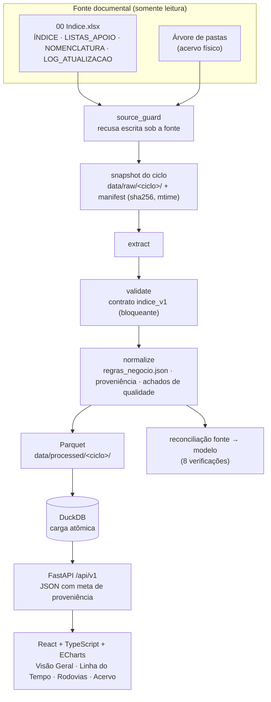

# Dashboard Jurídico — Legal Intelligence sobre um acervo documental vivo

> **Dados fictícios. Versão sanitizada de um sistema em uso real; identificadores do cliente foram substituídos.**

## Summary in English

Dashboard Jurídico is a local-first *legal intelligence* dashboard built for a road-infrastructure
program, on top of the document repository maintained by the program's law firm. It reads a
live, read-only index spreadsheet plus the physical folder tree, snapshots each ingestion cycle
(hash, size, mtime), normalizes it into a DuckDB/Parquet analytical model with declared
provenance for every field, and serves it through a FastAPI layer to a React + ECharts
front end (overview with global cross-filtering, timeline, roads & contracts, document explorer).
The source is protected by code (a `source_guard` that refuses any write under the source root,
plus a test that compares the inventory before and after a full cycle). This public copy ships
with an 18-item fictitious dataset; client names, roads, contracts and people were replaced.

---

## Problema

O contrato produz centenas de documentos jurídicos — pareceres, minutas, notificações,
advertências, ofícios — guardados numa pasta sincronizada do SharePoint e catalogados numa
planilha-índice (`00 Indice.xlsx`) mantida por outro projeto. A gestão precisava responder
perguntas simples — *quanto se produziu, sobre o quê, para quem, em qual rodovia e contrato* —
e a única forma era abrir a planilha e contar à mão.

Três complicações reais (registradas em `STATE.md` e `docs/DECISIONS.md`):

- **a fonte é viva**: em uma única tarde o acervo passou por 215 → 259 → 291 → 324 → 389
  documentos (`STATE.md`), então todo número precisa dizer de *quando* é;
- **a fonte é intocável**: o dashboard não pode escrever nada na pasta do Escritório Jurídico
  (`DEC-002`);
- **metadados imperfeitos**: rodovia e contrato não são colunas — precisam ser extraídos do
  texto, e a primeira versão do regex gerou rodovias que não existiam (`DEC-014`).

## Solução

Um pipeline de ingestão somente-leitura + API + dashboard executivo, rodando inteiro na
máquina local (API em `127.0.0.1`, sem telemetria):

- **snapshot por ciclo** (`DEC-020`): cópia do índice + inventário do disco com hash,
  tamanho e mtime; todo número da tela carrega o `ciclo_id`;
- **dois relógios explícitos** (`DEC-021`): "dados estruturados atualizados em" ×
  "inventário físico observado em", com contagem de documentos aguardando indexação —
  defasagem não é exibida como erro;
- **proveniência declarada** em cada campo derivado (`source`, `derived`,
  `confirmed_business_rule`, `inferred`, `taxonomy_pending`, `missing` — `DEC-005`);
- **regras de negócio fora do código**, em `config/regras_negocio.json` versionado
  (`DEC-017`): mapa contrato ↔ rodovia ↔ executora, regra `RD-102` (sem `B` explícito é
  `RD-102A`), macrogrupos jurídicos, arquivos de controle;
- **RESUMO → EXPLORAÇÃO → EVIDÊNCIA**: todo KPI e todo elemento de gráfico navega para o
  Acervo Documental com o recorte, e de lá para o link original do documento (`DEC-008`,
  `DEC-011`: filtros vivem na URL).

## Arquitetura



Fronteiras (detalhe em `docs/ARCHITECTURE.md`): o frontend nunca lê Excel nem recalcula
agregação; a API nunca lê a fonte, só o DuckDB; só a ingestão toca a fonte, e só para ler.

| Camada | Onde |
|---|---|
| Guarda da fonte | `backend/pipeline/source_guard.py` |
| Pipeline (snapshot → extract → validate → normalize → load) | `backend/pipeline/` |
| Contrato estrutural do índice | `backend/pipeline/contracts/indice_v1.py` |
| Regras de domínio | `config/regras_negocio.json` |
| API | `backend/app/` (FastAPI, repositório DuckDB, serviços) |
| Frontend | `frontend/src/` (features por página, `charts/`, `ui/`) |
| Dados fictícios | `examples/demandas_ficticias.json` + `examples/gerar_fonte_ficticia.py` |

## Números

Medidos no sistema real; fonte entre parênteses. Na versão pública os dados são outros.

| Medida | Valor | Fonte |
|---|---|---|
| Documentos indexados no último ciclo registrado | 397 (392 ativos, 5 excluídos) | `STATE.md`, ciclo de 11/09/2026 |
| Lacunas de indexação / pendentes de reconciliação | 0 / 0 | `STATE.md` |
| Vínculos documento ↔ tema | 553 | `STATE.md` |
| Documentos com rodovia identificada / com contrato | 182 / 163 | `STATE.md` |
| Testes de frontend (Vitest) | 120 passando, 10 arquivos | `STATE.md`, execução de 22/09/2026 |
| Testes Python (pytest) | 115 passando · 1 falha · 20 erros conhecidos (fonte mudou e não foi reprocessada; todos em `test_pipeline_integracao.py`) | `STATE.md`, execução de 22/09/2026 |
| Decisões de arquitetura/produto registradas | 34 (`DEC-001` … `DEC-034`) | `docs/DECISIONS.md` |
| Endpoints da API | 24 rotas `GET` em `/api/v1` | `backend/app/api/v1/` |

Na versão pública, com o dataset fictício: 18 demandas (17 ativas, 1 excluída), 31 vínculos
de tema, 7 documentos com rodovia, 6 com contrato e as 8 verificações de reconciliação OK.

## Como rodar (com os dados fictícios)

Pré-requisitos: Python 3.12+, Node 20+.

```powershell
# 1. dependências
python -m pip install fastapi "uvicorn[standard]" pydantic duckdb pyarrow pandas openpyxl
python -m pip install pytest httpx ruff        # desenvolvimento
cd frontend; npm install; cd ..

# 2. gerar a fonte fictícia (examples/fonte-ficticia/: 00 Indice.xlsx + 17 "documentos")
python examples/gerar_fonte_ficticia.py

# 3. construir o modelo analítico (config/config.example.json já aponta para a fonte fictícia)
python -m backend.pipeline.run --full

# 4. subir API e frontend
python -m uvicorn backend.app.main:app --host 127.0.0.1 --port 8000
cd frontend; npm run dev        # http://127.0.0.1:5173
```

Atalho no Windows: `.\scripts\start_dev.ps1` (sobe as duas janelas e abre o navegador).
OpenAPI em `http://127.0.0.1:8000/docs`.

Testes (depois do passo 3):

```powershell
python -m pytest tests -q
cd frontend; npm run test
```

O dataset fictício (`examples/demandas_ficticias.json`) tem o mesmo layout do índice real
(contrato `indice_v1`): naturezas, assuntos, destinatários, temas multivalorados,
necessidade de resposta, log de varreduras e hyperlinks. Nenhuma demanda, processo,
pessoa, rodovia ou contrato ali existe.

## Limitações conhecidas

- Uso **local e monousuário**: API em `127.0.0.1`, sem autenticação, multiusuário ou deploy em nuvem (fora de escopo em `docs/ROADMAP.md`).
- Lê só o índice e o inventário de pastas: não abre o conteúdo de PDF/DOCX, não faz OCR nem NLP.
- Rodovia e contrato são extraídos do texto por regras; documento sem rodovia identificável aparece como ausência, nunca como "Geral" (`DEC-026`). No último ciclo do sistema real, 182 de 397 documentos tinham rodovia identificada.
- Os hyperlinks para os documentos originais não são validados por HTTP (exigiria autenticação no SharePoint).
- Sem teste ponta a ponta de navegador; o bundle do frontend tem ~1,07 MB (343 KB gzip, a maior parte é ECharts) e ainda não tem code-splitting por página.
- Se o layout da planilha-índice mudar, o pipeline aborta sem gravar nada (contrato estrutural `indice_v1`).

## O que eu decidi × o que a IA gerou

O código foi escrito com **Claude Code** (e Codex) como ferramenta, sob revisão da autora
(`PROVENANCE.md`: "assistentes de IA usados como ferramenta, sem autoria"). A divisão abaixo
segue o que está registrado em `docs/DECISIONS.md`, `config/regras_negocio.json` e `STATE.md`.

**Decisões da autora** (registradas como "confirmada/decidida pela usuária"):

- regras de negócio do domínio, confirmadas em 10/09/2026 e versionadas em
  `config/regras_negocio.json`: o mapa contrato ↔ rodovia ↔ executora (`DEC-010`), a regra
  `RD-102` → `RD-102A`, `Empreiteiras` como destinatário válido, siglas exibidas sem expansão;
- os projetos permanecem desacoplados — nada de ler os `backups/` do projeto vizinho (`DEC-012`);
- `Minuta` é estágio, não matéria (`DEC-019`); taxonomia divergente é estado, não erro
  (`DEC-022`); contencioso entra como corte, não como página (`DEC-023`);
- macrogrupo jurídico fica fora dos KPIs principais (`DEC-019`); remoção da média móvel
  (`DEC-030`); itens de menu, rodapé e selos removidos "a pedido da usuária"
  (`frontend/src/brand/product.ts`, `STATE.md`);
- uso de gerador de imagem só para asset visual sintético, com fronteira escrita, e proibição
  de modelos treinados em rosto (`DEC-031`, `DEC-032`);
- commits só por pedido explícito, revisão visual antes de cada commit (`CLAUDE.md`, `STATE.md`).

**Gerado com IA sob revisão da autora:** a implementação do pipeline, da API e do frontend;
os testes; a redação dos registros de decisão e da documentação técnica; a análise que levou
ao bug do regex por campo (`DEC-014`).

## Stack

Python 3.12 · FastAPI · Pydantic v2 · DuckDB · Parquet (PyArrow) · pandas · openpyxl ·
pytest · Ruff — React 18 · TypeScript strict · Vite 6 · Tailwind 3 · Radix (estilo shadcn/ui) ·
Apache ECharts 5 · TanStack Query · Vitest.

## Documentação

| Arquivo | Conteúdo |
|---|---|
| `STATE.md` | estado do projeto, números do último ciclo, pendências |
| `CLAUDE.md` | instruções permanentes do projeto para o agente |
| `docs/ARCHITECTURE.md` | arquitetura técnica e contratos entre camadas |
| `docs/DATA_MODEL.md` | fatos, dimensões, pontes, linhagem |
| `docs/DECISIONS.md` | 34 decisões registradas |
| `docs/PRODUCT_SPEC.md` · `docs/UI_UX.md` · `docs/VISUAL_REDESIGN.md` | produto e design |
| `docs/README-original-sanitizado.md` | README original (endpoints, rotas, princípios) |

## Verificação, sanitização e licença

- **Testes:** `py -3.12 -m pytest tests -q -p no:cacheprovider` → **149 passed, 1 skipped** (o teste pulado depende de dado real) e Vitest do frontend → **120 passed**, em 19/11/2026.
- **Dados:** fictícios — cópia sanitizada de um sistema em uso real; nenhum dado de cliente ou de terceiro.
- **Sanitização:** o que foi removido, trocado ou inventado nesta cópia está em [`SANITIZACAO.md`](SANITIZACAO.md).
- **Licença:** todos os direitos reservados; leitura permitida para avaliação de portfólio — ver [`LICENSE`](LICENSE) e [`NOTICE`](NOTICE).

---

> **Dados fictícios. Versão sanitizada de um sistema em uso real; identificadores do cliente foram substituídos.**
> Autora: Emmily Maciel — contato pelo perfil GitHub [@Emmilymaciell](https://github.com/Emmilymaciell).
